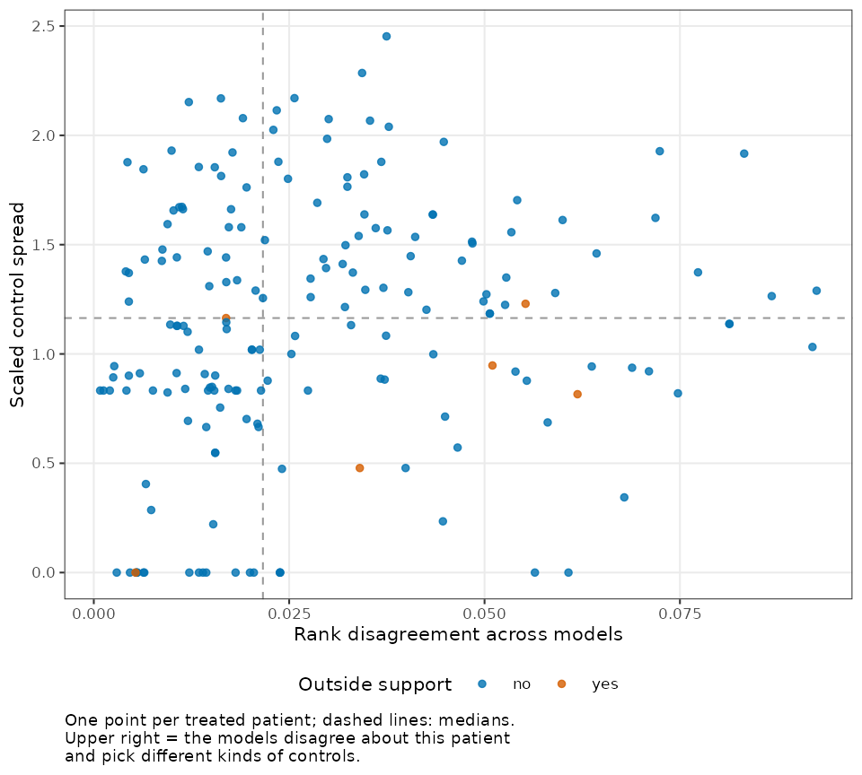
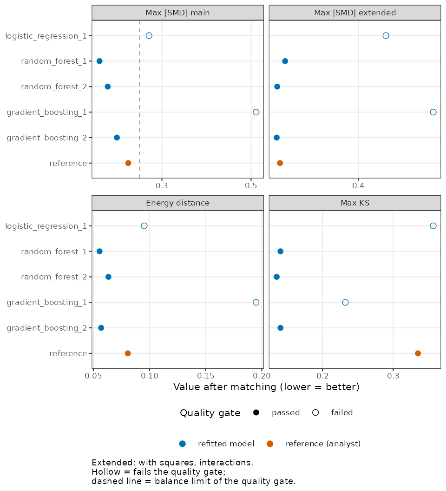
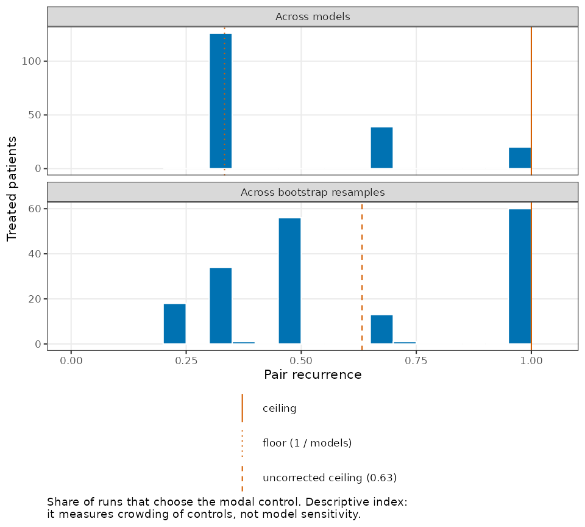

# Getting started with propsens

## Why this check

A matched study estimates the propensity score with one model, usually
logistic regression. Another equally reasonable model, such as Bayesian
additive regression trees or a generalized random forest, would rank the
patients differently, give some treated patients different untreated
partners, and could change the matched design. `propsens` measures how
much the design depends on that choice, **without looking at outcomes**,
so it can be run at the design stage, next to the usual balance table.

**Status of the evidence.** The diagnostics are evaluated in a
manuscript in preparation (Abbas, *Do equally good propensity models
agree on whom to match?*). Until it is available, report the output as a
description of how much the matched design depends on the choice of
propensity model, not as a validated check.

For a short overview, see [propsens at a
glance](https://mostafa-abbas.github.io/propsens/articles/at-a-glance.md)
([`vignette("at-a-glance", package = "propsens")`](https://mostafa-abbas.github.io/propsens/articles/at-a-glance.md)).
For the method explained one idea at a time with a real clinical
example, see [How propsens works, step by
step](https://mostafa-abbas.github.io/propsens/articles/how-it-works.md)
([`vignette("how-it-works", package = "propsens")`](https://mostafa-abbas.github.io/propsens/articles/how-it-works.md)).

It answers two questions:

- **Study level:** would an equally reasonable propensity model give a
  matched design with different balance?
- **Patient level:** which treated patients get a different *kind* of
  untreated partner under a different model?

## One call on your own `matchit` object

``` r

library(propsens)
data("lalonde", package = "MatchIt")

matched <- MatchIt::matchit(
  treat ~ age + educ + race + married + nodegree + re74 + re75,
  data = lalonde, method = "nearest", distance = "glm", link = "linear.logit",
  replace = TRUE
)
```

[`propensity_sensitivity()`](https://mostafa-abbas.github.io/propsens/reference/propensity_sensitivity.md)
reads the formula and the matching options from the object, refits the
propensity model with logistic regression, Bayesian additive regression
trees (BART) and a generalized random forest (three seeds for each tree
algorithm, cross-fitted scores), re-matches with the same options, and
computes the diagnostics, with 20 bootstrap refits of the logistic
model. This is the model set evaluated in a manuscript in preparation,
and it is the one to use in an analysis:

``` r

sensitivity <- propensity_sensitivity(matched)
```

It takes about a minute on these data. So that this vignette builds
quickly, the run below uses an earlier, faster model set (logistic
regression, random forests and gradient boosting), fewer seeds and fewer
refits.

``` r

sensitivity <- propensity_sensitivity(
  matched, algorithms = c("logistic_regression", "random_forest", "gradient_boosting"),
  seeds = 1:2, n_trees = 100, bootstrap_samples = 5
)
sensitivity
#> Propensity model sensitivity
#> 1. Quality gate: 3 of 5 models kept (2 algorithms: random forest, gradient boosting); log-loss within 5 % of the best; relative balance rule: max |SMD| main terms at most 0.1 above the best model's and <= 0.25, limit here 0.25
#>    Excluded:
#>      logistic_regression_1: log-loss above (1 + quality_tolerance) x best; max |SMD| main terms more than balance_margin above the best model's or above balance_cap
#>      gradient_boosting_1: max |SMD| main terms more than balance_margin above the best model's or above balance_cap
#> 2. Rank disagreement (study mean over treated): 0.0286; median between/within ratio 4.5 (exploratory; near 1 = seed noise)
#>    Pair instability across the models in use (study mean over treated; exploratory): 0.524
#>    Bootstrap rank instability of the logistic model (study mean over treated): 0.0361
#> 3. Balance spread (range of max |SMD| main terms across the models in use): 0.0389 (0.16 to 0.199)
#> Mean scaled control spread over treated (descriptive): 1.13 (1 = controls differ as much as a typical match differs from its treated patient)
#> Treated kept: 100 % (lowest model in use)
#> Reference model (glm, linear.logit): passes the balance gate; mean absolute rank difference from the models in use: 0.104
```

How to read the printed lines:

- **Models in use.** A model enters the “equally reasonable” set only if
  its cross-fitted log-loss is within 5 % of the best model and its
  largest standardized mean difference on main terms after matching is
  at most 0.10 above the best model’s and at most 0.25 (the relative
  balance rule; `balance_rule = "absolute"` uses a fixed 0.10 instead).
  If fewer than two models pass, all models are used and the output
  starts with a warning: the diagnostic is then outside the setting
  where it was evaluated. The line on the quality gate states the rule.
- **Mean rank disagreement.** For each patient, the standard deviation
  over models of the patient’s percentile rank of the propensity score;
  averaged over treated patients. 0 means every model orders the
  patients the same way. Read it for the study as a whole, not per
  patient (evaluated in a manuscript in preparation).
- **Bootstrap rank instability.** The standard deviation of a patient’s
  percentile rank over bootstrap refits of the logistic model, averaged
  over treated patients. Report it next to rank disagreement; the two
  are evaluated together in a manuscript in preparation.
- **Between/within ratio.** Disagreement between algorithms divided by
  disagreement between seeds of the same algorithm. Near 1 means the
  algorithms disagree with each other no more than one tree algorithm
  disagrees with itself: seed noise, not model dependence.
- **Scaled control spread.** For each treated patient, how different the
  untreated partners chosen by the different models are, in units of a
  typical distance between a treated patient and its partner. 1 means
  the candidate partners differ from each other as much as a typical
  match differs from its treated patient.
- **Balance range and treated kept.** The spread of the maximum
  standardized mean difference across the models in use, and the share
  of treated patients kept (below 100 % only with a caliper).
- **Reference model.** Your own model from the `matchit` object, kept as
  a reference. Its log-loss is not computed (it is an in-sample score)
  and it is judged on balance only.

[`summary()`](https://rdrr.io/r/base/summary.html) gives every
study-level number with and without the quality gate, and the table of
models:

``` r

summary(sensitivity)
#> 1. Quality gate: 3 of 5 models kept (2 algorithms: random forest, gradient boosting); log-loss within 5 % of the best; relative balance rule: max |SMD| main terms at most 0.1 above the best model's and <= 0.25, limit here 0.25
#>    Excluded:
#>      logistic_regression_1: log-loss above (1 + quality_tolerance) x best; max |SMD| main terms more than balance_margin above the best model's or above balance_cap
#>      gradient_boosting_1: max |SMD| main terms more than balance_margin above the best model's or above balance_cap
#> 2. Rank disagreement (study mean over treated): 0.0286; median between/within ratio 4.5 (exploratory; near 1 = seed noise)
#>    Pair instability across the models in use (study mean over treated; exploratory): 0.524
#>    Bootstrap rank instability of the logistic model (study mean over treated): 0.0361
#> 3. Balance spread (range of max |SMD| main terms across the models in use): 0.0389 (0.16 to 0.199)
#> 
#> Study-level numbers (with the quality gate / without it):
#>                                         quantity with_gate without_gate
#>                            number_of_models_used   3.00000       5.0000
#>                   mean_rank_disagreement_treated   0.02860       0.0575
#>                       mean_rank_disagreement_all   0.04450       0.0675
#>              median_between_within_ratio_treated   4.50000       7.8100
#>                  mean_logit_disagreement_treated   0.44800       0.6340
#>               mean_control_spread_scaled_treated   1.13000       1.2200
#>                p90_control_spread_scaled_treated   1.88000       1.7000
#>                               smd_max_main_range   0.03890       0.3510
#>                                  smd_max_main_sd   0.01950       0.1450
#>                           smd_max_extended_range   0.01800       0.3330
#>                              smd_max_extended_sd   0.01000       0.1560
#>                            energy_distance_range   0.00792       0.1390
#>                               energy_distance_sd   0.00422       0.0591
#>                                     ks_max_range   0.00541       0.2220
#>                                        ks_max_sd   0.00312       0.0960
#>              pair_recurrence_models_mean_treated   0.47600       0.3280
#>             pair_instability_models_mean_treated   0.52400       0.6720
#>           pair_recurrence_bootstrap_mean_treated   0.62000       0.6200
#>                               treated_kept_share   1.00000       1.0000
#>                           treated_kept_share_min   1.00000       1.0000
#>               bootstrap_rank_instability_treated   0.03610       0.0361
#>  reference_mean_absolute_rank_difference_treated   0.10400       0.0886
#> 
#> Models:
#>               model_id                     algorithm logloss smd_max_main
#>  logistic_regression_1           logistic_regression   0.412        0.271
#>        random_forest_1                 random_forest   0.363        0.160
#>        random_forest_2                 random_forest   0.360        0.178
#>    gradient_boosting_1             gradient_boosting   0.351        0.511
#>    gradient_boosting_2             gradient_boosting   0.351        0.199
#>              reference reference (glm, linear.logit)      NA        0.224
#>  smd_max_extended energy_distance ks_max treated_kept passed_quality_gate
#>             0.459          0.0953  0.357            1               FALSE
#>             0.244          0.0555  0.141            1                TRUE
#>             0.227          0.0634  0.135            1                TRUE
#>             0.560          0.1950  0.232            1               FALSE
#>             0.226          0.0569  0.141            1                TRUE
#>             0.233          0.0806  0.335            1                TRUE
#>  in_use
#>   FALSE
#>    TRUE
#>    TRUE
#>   FALSE
#>    TRUE
#>   FALSE
#>                                                                                                                                 gate_note
#>  log-loss above (1 + quality_tolerance) x best; max |SMD| main terms more than balance_margin above the best model's or above balance_cap
#>                                                                                                                                    passed
#>                                                                                                                                    passed
#>                                                 max |SMD| main terms more than balance_margin above the best model's or above balance_cap
#>                                                                                                                                    passed
#>                       in-sample score from the user's object, not comparable (log-loss not computed); gate judged on balance only: passed
#> 
#> Quality gate: log-loss within 5 % of the best; relative balance rule: max |SMD| main terms at most 0.1 above the best model's and <= 0.25, limit here 0.25
#> Matching: 1:1 nearest neighbour on the logit, ATT, with replacement, order "largest", caliper none
```

The per-patient table is available with
[`as.data.frame()`](https://rdrr.io/r/base/as.data.frame.html):

``` r

head(as.data.frame(sensitivity))
#>     id treated rank_disagreement rank_disagreement_between
#> 1 NSW1       1       0.009951304               0.002303279
#> 2 NSW2       1       0.035346147               0.043186489
#> 3 NSW3       1       0.021240391               0.024760254
#> 4 NSW4       1       0.002617712               0.002015369
#> 5 NSW5       1       0.019549628               0.022744884
#> 6 NSW6       1       0.014620231               0.017562506
#>   rank_disagreement_within logit_disagreement control_spread
#> 1              0.013819677          0.1523580       4.987492
#> 2              0.003454919          0.1689781       5.341489
#> 3              0.009213118          0.7281597       2.634231
#> 4              0.002879099          1.5019469       2.439757
#> 5              0.008637298          0.2889737       1.814653
#> 6              0.004030739          0.4403734       2.151607
#>   control_spread_scaled pair_recurrence_models pair_recurrence_bootstrap
#> 1             1.9302110              0.3333333                 0.3333333
#> 2             2.0672113              0.6666667                 1.0000000
#> 3             1.0194744              0.6666667                 0.2500000
#> 4             0.9442110              0.6666667                 1.0000000
#> 5             0.7022896              0.3333333                 0.3333333
#> 6             0.8326943              0.6666667                 0.2500000
#>   outside_support logistic_score
#> 1           FALSE      0.3950590
#> 2           FALSE     -1.3019135
#> 3           FALSE      0.5733472
#> 4           FALSE      1.2414886
#> 5           FALSE      0.8807265
#> 6           FALSE      0.9013876
```

## The three plots

**Patients.** One point per treated patient: rank disagreement across
models (x) against the scaled control spread (y). The upper right holds
the patients about whom the models disagree *and* who receive different
kinds of untreated partners: these are the patients that make the design
fragile. Colour shows whether the patient’s logistic score lies outside
the range of the untreated patients’ scores.

``` r

plot(sensitivity, type = "patients")
```



**Models.** The four balance statistics after matching, one panel each,
one row per model. Hollow points fail the quality gate; your own model
is drawn in its own colour. A wide spread across models means the
balance you report depends on the model you happened to choose.

``` r

plot(sensitivity, type = "models")
```



**Recurrence.** The pair recurrence: the share of models (or bootstrap
refits) that choose a treated patient’s most common untreated partner.
One minus its mean over treated patients across models is pair
instability, printed under rank disagreement: the second summary of the
same gated model set, exploratory, while rank disagreement stays the
primary summary. When untreated patients are dense the recurrence is
often near its floor.

``` r

plot(sensitivity, type = "recurrence")
```



## Without a `matchit` object

The same diagnostic runs on a formula and a data frame; the matching
options are then arguments (without replacement, order “largest”, no
caliper by default):

``` r

propensity_sensitivity(treat ~ age + educ + race + married + nodegree + re74 + re75,
                       data = lalonde)
```

## What to do with the result

1.  Show the models plot next to your balance table.
2.  Choose the design by balance, never by the outcome.
3.  If the design is fragile, report the range of estimates across the
    models in a supplement.
4.  Look at the treated patients in the upper right of the patients
    plot: do they sit in a region of the covariates with few untreated
    patients?

The check does not detect unmeasured confounding and is not a fix: it
tells you how much your matched design depends on one modelling choice.
