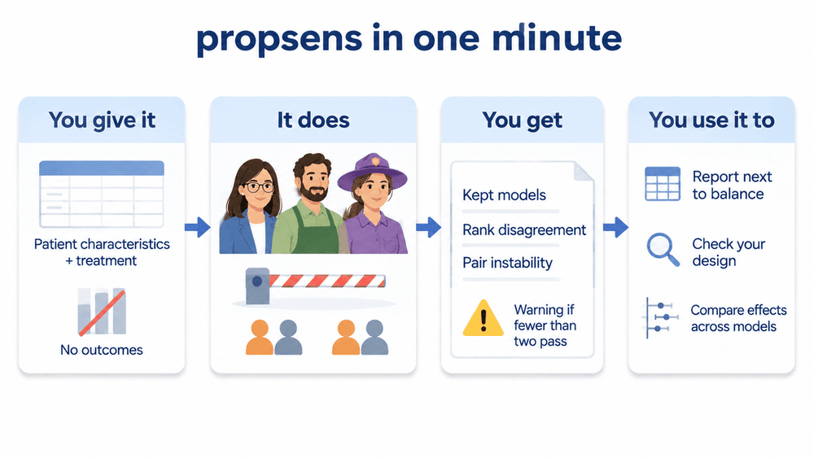
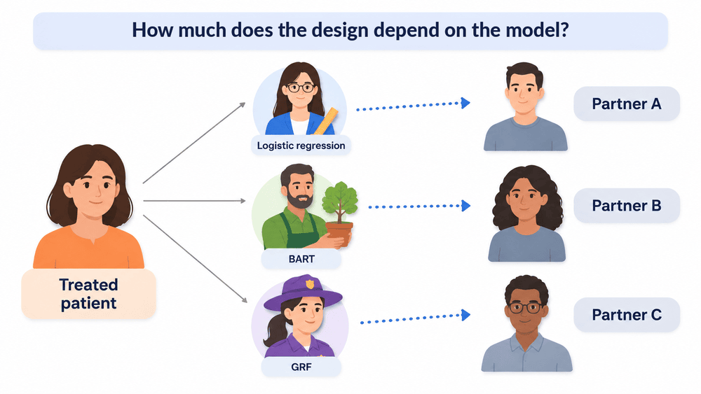
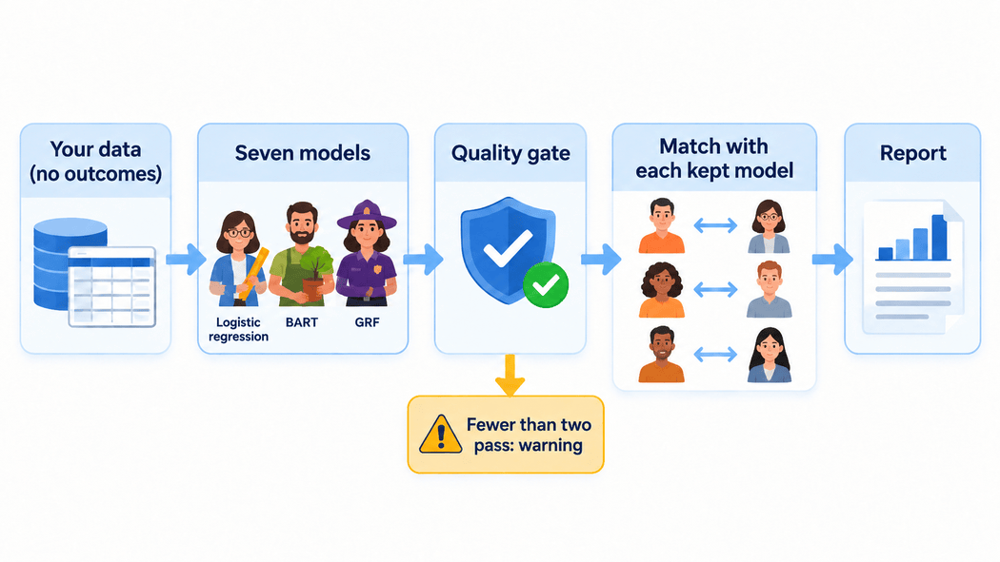
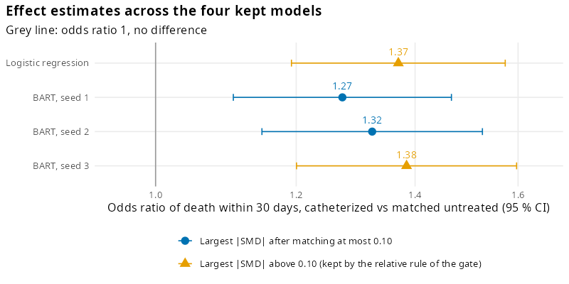

```{r setup, include = FALSE}
knitr::opts_chunk$set(collapse = TRUE, comment = "#>")
models <- utils::read.csv("rhc-models.csv")
study <- utils::read.csv("rhc-study.csv")
value <- function(name) study$value[study$quantity == name]
kept <- models[models$passed_quality_gate, ]
two_decimals <- function(x) sprintf("%.2f", x)
```

## propsens in one minute

{width=100% alt="Four panels joined by arrows under the heading propsens in one minute. You give it: patient characteristics and treatment, no outcomes. It does: three kinds of model, a barrier for the quality gate, and matched pairs. You get: kept models, rank disagreement, pair instability, and a warning if fewer than two pass. You use it to: report next to balance, check your design, report effects under every kept model, if planned."}

| | |
|---|---|
| **You give it** | Your study data (patient characteristics and treatment, no outcomes) and your matching settings, or your existing `MatchIt` object. |
| **It does** | Fits seven propensity models, keeps those that fit and balance about as well as the best one (the quality gate), and repeats your matching with each kept model. |
| **You get** | The list of kept models; rank disagreement (how much patients' positions move between kept models); pair instability (how often kept models choose different partners); the balance of each model's match; an R warning if fewer than two models pass, or if the kept models are seeds of one algorithm. |
| **You use it to** | (1) Report it next to your balance table, at the design stage, before looking at outcomes. (2) If a warning appears, revisit the matching design first. (3) Decide before looking at outcomes whether you will report the effect estimate under each kept model, and then report all of them, as in the [heart catheterization example](#how-to-read-it-the-heart-catheterization-example). |

```{r one-minute, eval = FALSE}
library(propsens)
# Replace the placeholders <...> with your own treatment, covariates and data:
result <- propensity_sensitivity(<treatment> ~ <covariate 1> + <covariate 2>,
                                 data = <your data frame>, replace = FALSE, caliper = 0.2)

# Or give your existing MatchIt object (its matching settings are read from the object):
result <- propensity_sensitivity(<your matchit object>)
```

## The question

A matched study pairs each treated patient with an untreated patient who looked alike before
treatment. To find those look-alikes, the researcher first estimates each patient's chance of
being treated with a statistical model, the **propensity model**. Several models can do this
job about as well. propsens asks:

> **How much does a matched design depend on which of several similarly good propensity models
> is used?**

{width=100% alt="A treated patient on the left and three propensity models in the middle (logistic regression, BART and GRF). Each model leads to a different untreated partner on the right (partners A, B and C). Heading: How much does the design depend on the model?"}

It answers this before anyone looks at the outcomes, so it belongs in the design stage of a
study, next to the usual table that compares the matched groups.

## What you run

The call shown above, then:

```{r run, eval = FALSE}
result                   # the report
seed_sensitivity(<your matchit object>)  # the same with seed = 1, 2 and 3; report all rows
```

{width=100% alt="The workflow from left to right: your data without outcomes; seven models (logistic regression, BART and GRF); a quality gate; matching with each kept model; a report. Below the gate, a warning sign: fewer than two pass, warning."}

## What you get

- **Kept models.** propsens fits seven propensity models and keeps only those that fit the data
  and balance the matched groups about as well as the best one.
- **Rank disagreement** (primary). How much the kept models disagree on the order in which they
  line up the treated patients by their chance of treatment. 0 means they all agree.
- **Pair instability** (exploratory). How often the kept models choose a different untreated
  partner for the same treated patient. It is high whenever many untreated patients have similar
  scores, even when the models agree.
- **Bootstrap rank instability and balance spread** (descriptive). How much the logistic model's
  ranks move from sampling alone, and how much the balance differs between the kept models.
- **A warning** (an R warning, repeated at the top of the output) if fewer than two models pass
  the quality gate, so that there is no set of similarly good models to compare, or if the kept
  models are seeds of one algorithm, so that the disagreement is only seed noise.

## How to read it: the heart catheterization example

The public data of a well-known study of right heart catheterization in critically ill patients
(Connors et al., *JAMA* 1996) has `r format(value("patients"), big.mark = ",")` patients,
`r format(value("treated"), big.mark = ",")` of them catheterized.

- **`r value("models_kept")` of `r value("models")` models were kept**: logistic regression and
  the three BART fits.
- **Rank disagreement was `r sprintf("%.3f", value("rank_disagreement"))`.** The standard
  deviation of a treated patient's percentile rank across the four kept models averaged
  `r sprintf("%.1f", 100 * value("rank_disagreement"))` points on the 0 to 100 scale. No
  thresholds for a "large" value exist yet.
- **Pair instability was `r sprintf("%.2f", value("pair_instability"))`** of a possible 0.75
  with four models: expected when many untreated patients have similar scores, and not by itself
  a sign that the matched groups differ.
- **Odds ratios of death within 30 days** (an illustration only; propsens never uses the
  outcome). Matching with each kept model gave odds ratios between
  `r two_decimals(min(kept$odds_ratio))` and `r two_decimals(max(kept$odds_ratio))`, all with
  wide and overlapping 95 % confidence intervals. The two ends of this range are two BART fits
  that differ only in their random seed, and each matched sample keeps a different
  `r sprintf("%.0f", 100 * value("treated_kept_min"))` to
  `r sprintf("%.0f", 100 * value("treated_kept_max"))` % of the catheterized patients, so the
  estimates describe slightly different groups. The example shows that the estimate is not
  identical across kept models; it does not show how much of the difference is due to the
  model, to the seed, or to chance.

{width=100% alt="Odds ratio of death within 30 days in the matched pairs of each of the four kept models, with 95 % confidence intervals: logistic regression and BART with seeds 1, 2 and 3. All four lie above 1, between about 1.27 and 1.38."}

## What it does not tell you

- **It describes the study as a whole.** It does not single out individual patients.
- **It does not say which model is right.** It says how much the choice among similarly good
  models matters.
- **It cannot tell whether a disagreement matters for the effect estimate.** Models can disagree
  about patients' ranks in ways that do not change the estimate, and agree while all being wrong
  in the same way. A small value is not evidence that the estimate is unbiased.
- **It does not address unmeasured confounding.** Every model uses the same recorded
  characteristics; a factor that was never recorded is missing from all of them.
- **With a caliper** (a maximum allowed distance between partners), **each model keeps a
  different set of treated patients**, so each matched design describes a slightly different
  group.

These diagnostics have been studied in the author's simulations and benchmark analyses; a
methods paper is in preparation. No peer-reviewed evaluation exists yet.

## Learn more

[How propsens works, step by step](how-it-works.html) explains each part of the method with the
same example.
